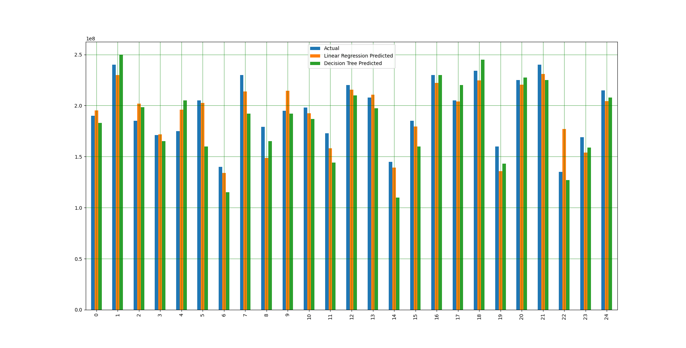
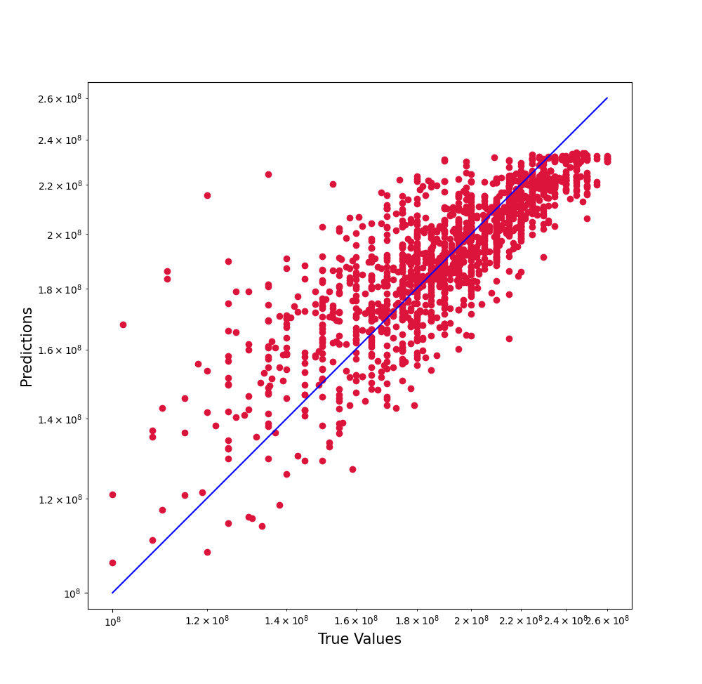

# Carify

Carify is a prototype for estimating used-car prices from listings in the Iranian market. The repository combines a Go data collector and API, a React interface, and Python scripts for exporting data and training regression models.

The project is split into independently run components. It does not currently provide a single-command local demo: the trained model is not checked in, the browser app points to a fixed API address, and some scripts assume a particular working directory. Start with the [setup guide](docs/development/setup.md) and review the [known constraints](docs/development/setup.md#current-repository-constraints) before trying the full flow.

## What it contains

| Component | Location | Purpose |
| --- | --- | --- |
| Data collector and preparation | [`data/`](data/) | Fetches Divar car listings, stores them in PostgreSQL, repairs selected fields, and creates one-hot encoded rows. |
| HTTP API | [`backend/`](backend/) | Serves form options and sends car features to the Python prediction script. |
| Web interface | [`frontend/`](frontend/) | React form for entering vehicle details and displaying the returned estimate. |
| Model scripts | [`regressor/`](regressor/) | Trains linear regression or decision tree models from exported CSV data. |
| CSV export | [`pycsv/`](pycsv/) | Exports the `pcars` PostgreSQL table to a CSV file. |
| Prediction adapter | [`predictor/`](predictor/) | Loads the trained Joblib model and predicts a price from one comma-separated feature row. |
| Plotting | [`plot/`](plot/) | Compares regression predictions and plots evaluation output. |
| Orchestrator | [`orchestrator/`](orchestrator/) | Legacy helper intended to run pipeline stages in sequence; see its documented limitations. |

## Architecture


Open the [diagram source](docs/architecture/carify-architecture.html) or see the [architecture guide](docs/architecture/overview.md) for component boundaries and data artifacts.

## Historical model plots

These project-authored plots are preserved as records of earlier experiments. They are not current benchmark results.

### Linear regression and decision tree comparison



### Linear regression predictions versus true prices



## API at a glance

The backend exposes these routes (the local address in the checked-in backend configuration is `http://127.0.0.1:8082`):

| Method | Path | Purpose |
| --- | --- | --- |
| `GET` | `/v1/site/settings/get` | Returns the supported colors, body conditions, chassis conditions, motor conditions, and gearbox choices. |
| `POST` | `/v1/costs/predict` | Accepts vehicle feature values and returns an estimated cost. |

Example request:

```json
{
  "year": 1394,
  "color_value": 20,
  "usage_km": 85000,
  "body_status_value": 1,
  "motor_status_value": 1,
  "rear_chassis_status_value": 1,
  "front_chassis_status_value": 1,
  "insurance": 6,
  "gearbox": 1
}
```

Successful responses use a `data` envelope, for example `{"data": 123456789}`. The numeric codes come from the settings endpoint. See the [API reference](docs/reference/api.md) for request details and current behavior.

## Getting started

1. Read the [development setup](docs/development/setup.md) for prerequisites, environment variables, and working-directory requirements.
2. Follow the [data pipeline guide](docs/services/data-pipeline.md) to collect and prepare listing data.
3. Follow the [model guide](docs/machine-learning.md) to export training data and create the model artifact expected by the API.
4. Start the [backend](docs/services/backend.md) and [frontend](docs/services/frontend.md) as separate processes.

The docs are indexed in [`docs/README.md`](docs/README.md).

## Technology

- Go modules for the data service, API, and legacy orchestrator
- PostgreSQL for raw and one-hot encoded car records
- Python, pandas, scikit-learn, and Joblib for model training and inference
- React 18 and Create React App scripts for the web interface

There is no root-level workspace, dependency lock for Python, Docker Compose file, or tracked trained model. See the setup guide for the implications.

## Project history

Carify was developed by [Mehdi Eidi](https://github.com/mehdieidi) and [Reyhaneh Golizadeh](https://github.com/ReyhanehGholizade). See [`LICENSE`](LICENSE) for license terms.
