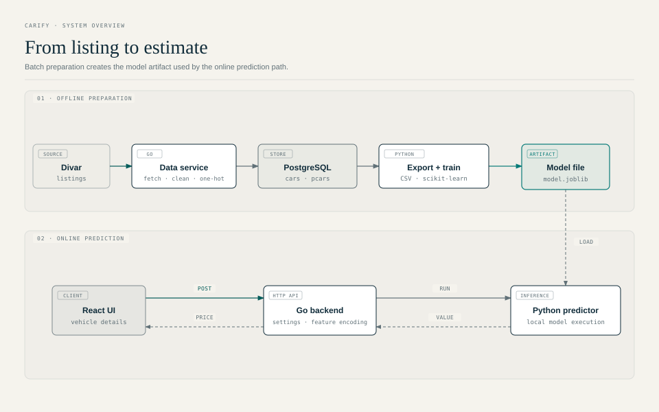
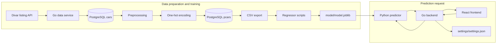

# Architecture overview

Carify has two connected flows: an offline data and training pipeline, and an online browser-to-prediction request path. The shared contract between them is the order and meaning of features in the `pcars` table, exported CSV, and model input row.

The [standalone HTML source](carify-architecture.html) contains the accessible vector diagram.

## Component diagram

## Offline pipeline

1. `data` searches Divar by configured cities and brand/model, retrieves listing details, and stores parsed fields in PostgreSQL `cars`.
2. The preprocessing stage updates source rows. It fills selected invalid values from the most common value or average, and deletes rows outside the configured cash-price interval.
3. One-hot encoding inserts one row per source car into `pcars`. It expands color, body condition, motor, chassis, and gearbox categories into indicator columns while keeping year, usage, insurance due, cost, and token fields.
4. `pycsv/to_csv.py` exports `pcars` to `pycsv/pcars_data.csv`.
5. A script in `regressor/` trains a scikit-learn model and writes `../model/model.joblib`.

See [Data pipeline](../services/data-pipeline.md) and [Machine learning](../machine-learning.md) for operational details.

## Online prediction path

1. The React app loads option values from `GET /v1/site/settings/get` and submits the selected values to `POST /v1/costs/predict`.
2. The Go API maps categorical codes to the same one-hot feature names used by the stored training data.
3. The API starts `python3 ../predictor/predictor.py`, writes a comma-separated feature row to the child process standard input, and parses the child's standard output as an integer.
4. The Python adapter loads the Joblib file and returns the predicted cost. The API wraps the integer as `{"data": ...}`.

The current implementation does not pass the submitted `insurance` value into the predictor feature row. The feature position is present but remains zero, even though insurance due is present in the training schema. The API guide records this behavior.

## Data and model contract

- `cars` stores scraped categorical values as integer codes and contains the original listing token and cash cost.
- `pcars` stores one-hot category fields plus numeric fields. It retains `cash_cost` as the supervised target and `car_token` as an identifier.
- The training scripts drop `cash_cost`, then select columns positionally from the exported CSV. That makes CSV column order part of the model contract.
- The predictor expects one comma-separated row in the same feature order and a model at `model/model.joblib` relative to the repository root when invoked from the backend directory.

The code does not persist feature names or preprocessing metadata alongside the Joblib model. When changing the `pcars` schema or feature order, update and retrain the model and keep the backend feature construction in sync.

## Runtime boundaries

- The Go API and Go data collector are separate processes and separate Go modules.
- The API reads categorical options from `backend/settings/settings.json`; it does not query the database for options.
- The API shells out to a local Python interpreter for each prediction; inference is not served by a separate network service.
- The React app is a static client and currently has its API origin hard-coded in `frontend/src/components/Home.js`.
- `orchestrator/` is a legacy runner and should not be treated as the authoritative pipeline entry point; its limitations are listed in the setup guide.
